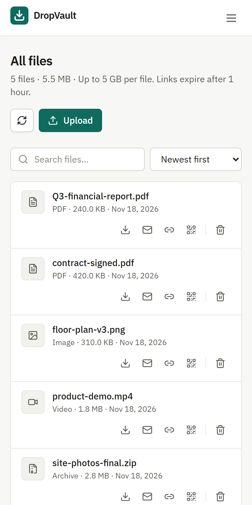

<h1 align="center">DropVault</h1>

<p align="center">
  Share files with links that expire. Serverless on AWS: upload big files in resumable parts, share by
  email, link or QR code, choose how long each link works and how many downloads it allows, see who
  downloaded what, and turn links off at any time.
</p>

<p align="center">
  <a href="./LICENSE"></a>
  
  
  
</p>

<p align="center">
  
</p>

## Features

- **Direct-to-S3 uploads, any size.** The browser uploads straight to S3 with presigned URLs and live
  progress. Files over 100 MB go up in parts, four at a time, with automatic retries. You can pause an
  upload and resume it later, even after closing the tab, by adding the same file again.
- **You choose how long links work:** 15 minutes, 1 hour (default), 6 hours, 1 day, 7 days or never.
- **Download limits (optional):** a link can stop after 1, 3, 5, 10 or 25 downloads. Limited links show a
  Download button first, so email scanners and chat previews don't use up a one-time link.
- **Share by email, link or QR code.** Each email recipient gets their own short link (Amazon SES), or copy
  a link, or show a scannable QR code. Every link redirects to a fresh download.
- **Download stats.** See every link for a file, how many times each was used and when, and who (for
  email shares) has downloaded it.
- **Turn links off,** one at a time or all of a file's links at once, without deleting the file.
  Deleting the file also removes its links.
- **Storage quota per user** (10 GB by default), shown as a usage bar and enforced on the server.
- **Unfinished uploads clean themselves up** after a day, in DynamoDB and in S3.
- **Clear dead-link pages.** Someone opening an expired or turned-off link sees a short page that says
  so (and when it expired), not a raw storage error.
- **Simple accounts.** Name, email and password. Sessions renew automatically for up to 30 days.
- **Admin panel** at `/admin` for the people you choose: totals and charts of sign-ups, uploads, links
  and downloads; every account, file and link, searchable and exportable as CSV; make admins, suspend
  accounts, set someone's storage limit, reset passwords, sign people out everywhere, delete accounts,
  files and links; an activity feed with an audit log of every admin action; and system health (alarms,
  API traffic, errors and Lambda timings from CloudWatch).
- **Light and dark mode**, following your system setting or chosen manually.
- **Encryption at rest:** SSE-S3 by default, or one KMS key for the app, or one KMS key **per user**.
- **One-command deploy** with Terraform, and a **fully offline mode** using LocalStack.
- **Tested and monitored:** pytest suite against a mocked AWS, GitHub Actions CI, and CloudWatch alarms
  that can email you when something breaks.

| Light | Dark |
| --- | --- |
|  |  |
|  |  |

## Architecture

```
                        ┌──────────────────────────┐
  Browser ──────────────► Amplify Hosting          │  React app (static)
     │                  └──────────────────────────┘
     │ REST, Bearer token
     ▼
  API Gateway (REST) ───► Lambda: auth-service ─────► DynamoDB: users
     │                    (sign-up, login, userinfo, refresh)
     │
     │  Lambda authorizer: checks the token (and that the account is still active),
     │  result cached 5 min
     │
     ├──────────────────► Lambda: upload (+ parts), complete, list, download, share, delete
     │                        ├──► DynamoDB: files (files, links, usage; 2 indexes)
     │                        ├──► S3 (private bucket, SSE-S3 or SSE-KMS)
     │                        ├──► KMS (optional per-user keys)
     │                        └──► SES (share emails)
     │
     ├──────────────────► Lambda: qr-link  links, stats, turn off; public /v1/d/{code}
     │
     └──────────────────► Lambda: admin  /v1/admin/*, admins only: both tables, S3, CloudWatch

  Browser ── presigned PUT (or parts) / GET ──► S3   (file bytes never go through Lambda)

  DynamoDB TTL removes an unfinished upload ──stream──► Lambda: cleanup ──► S3 (abort / delete)
  CloudWatch alarms (Lambda errors, API 5xx) ──► SNS ──► your email
```

Protected routes run a **Lambda authorizer** before the file Lambdas. With the built-in auth service it
verifies the token's signature itself and then reads the account, so a deleted, suspended or signed-out
account is turned away; with an external `auth_endpoint` it asks that service's `/v1/userinfo`. API
Gateway caches the answer per token, so most requests skip it entirely.

## Project structure

```
.
├── endpoints/                 Python 3.13 Lambda handlers (one folder per function)
│   ├── common/python/         shared code, deployed as a Lambda layer: auth, accounts (roles),
│   │                          api, storage, deletion, links, usage (quota), stats, tokens, ...
│   ├── auth-service/          sign-up, sign-in, userinfo, refresh (PBKDF2 passwords, HMAC tokens)
│   ├── authorizer/            API Gateway authorizer: checks the token in front of every file route
│   ├── upload-file/           start an upload (single PUT or multipart) + presigned part URLs
│   ├── complete-upload/       finish an upload, count it against the quota, mark it READY
│   ├── get-user-files/        list the caller's files and storage usage (DynamoDB index, no scan)
│   ├── download-file/         presigned GET URL (1 hour)
│   ├── share-file/            email one short link per recipient via SES
│   ├── delete-user-file/      delete the object (or abort the upload), its record and its links
│   ├── qr-link/               short links: create, list with stats, turn off, public redirect
│   ├── admin/                 the admin panel's API (admins only, audit-logged)
│   └── cleanup/               remove abandoned uploads from S3 (DynamoDB stream)
├── tests/                     pytest suite, runs against a mocked AWS (moto)
├── .github/workflows/ci.yml   lint + tests, terraform fmt/validate, web build
├── terraform/                 all AWS infrastructure
│   ├── deploy.sh              terraform apply → build web app → publish to Amplify / S3
│   ├── auth.tf  qr.tf         the auth and links Lambdas, their routes and the users table
│   ├── authorizer.tf          the Lambda authorizer + CORS on API Gateway's own errors
│   ├── admin.tf               the admin Lambda, its own IAM role and its /v1/admin route
│   ├── apigateway.tf          REST API, routes, CORS
│   ├── lambda.tf  layers.tf   file Lambdas + the shared code and jsonschema layers
│   ├── s3.tf  dynamodb.tf     storage, CORS, lifecycle; table, indexes, TTL, stream
│   ├── cleanup.tf             stream → cleanup Lambda for abandoned uploads
│   ├── monitoring.tf          CloudWatch alarms → SNS topic (→ alert_email)
│   ├── kms.tf  ses.tf         encryption modes, sender email identity
│   ├── web.tf                 Amplify Hosting or S3 + CloudFront
│   └── terraform.tfvars.example
├── web/                       React 19 + Vite + Tailwind CSS 4 front end
│   └── src/
│       ├── pages/             Landing, Login, SignUp, dashboard/Files, dashboard/DashboardLayout,
│       │                      admin/ (Overview, Users, UserDetail, Files, Links, Activity, System)
│       ├── components/        UI primitives, toasts, auth layout
│       ├── context/           AuthContext (session + automatic token renewal)
│       ├── api/               auth and file API clients
│       └── theme.jsx          light / dark / system theme
├── local/                     offline stack: LocalStack + a local API server running the real Lambdas
└── postman/                   API collection (sign up → upload → share → QR → delete)
```

## Getting started

### Option 1: run it offline (no AWS account)

Needs Docker Desktop, Python 3 (`pip install boto3 jsonschema`) and Node 20+.

```powershell
powershell -ExecutionPolicy Bypass -File local\start.ps1
```

This starts LocalStack (S3, DynamoDB, KMS, SES in Docker), a local API on `http://localhost:4000` that runs
the real Lambda handlers, and the web app on `http://localhost:3001`. Add `-AdminEmail you@example.com` and
sign up with that address to get the admin panel at `http://localhost:3001/admin`. Emails are captured, not sent; read
them at `http://localhost:4566/_aws/ses`. Details in [local/README.md](./local/README.md).

### Run the tests

No AWS account or Docker needed: the tests run the real Lambda handlers against
[moto](https://github.com/getmoto/moto), an in-memory AWS.

```bash
python -m venv .venv && .venv/Scripts/activate      # Windows; on macOS/Linux: source .venv/bin/activate
pip install -r requirements-dev.txt
ruff check .        # lint
pytest              # tests
```

GitHub Actions runs the same checks, plus `terraform fmt`/`validate` and the web build, on every push.

### Option 2: deploy to AWS

Needs Terraform ≥ 1.5, the AWS CLI with credentials (`aws configure`), Python 3, Node 20+ and bash
(Git Bash on Windows).

```bash
cd terraform
cp terraform.tfvars.example terraform.tfvars   # set aws_region and sender_email
bash deploy.sh
```

`deploy.sh` runs `terraform apply`, builds the web app with the new API URL baked in, publishes it and
prints both URLs:

```
Web app : https://main.<app-id>.amplifyapp.com
API     : https://<api-id>.execute-api.<region>.amazonaws.com/dev
```

After the first deploy, AWS emails `sender_email` a verification link. Click it, or sharing by email won't work.

To use the admin panel, put your email in `admin_emails` in `terraform.tfvars`, deploy, and sign up (or sign
in) with that address. **Admin** then appears in the sidebar; `terraform output admin_url` prints the link.

Run `bash deploy.sh` again after any change. To remove everything (S3 objects included):

```bash
terraform destroy -var-file=terraform.tfvars
```

### Configuration

The main `terraform.tfvars` settings (see [the example](./terraform/terraform.tfvars.example) for all of them):

| Variable | Default | Purpose |
| --- | --- | --- |
| `aws_region` | `eu-west-1` | Region for everything |
| `sender_email` | - | Address share emails come from (verified by SES on first deploy) |
| `web_hosting` | `amplify` | `amplify`, or `cloudfront` (S3 + CloudFront; new AWS accounts must be verified by AWS Support first) |
| `kms_mode` | `s3` | `s3` (SSE-S3, free), `shared` (one KMS key), `per_user` (one KMS key per user) |
| `auth_endpoint` | `""` | Empty = built-in auth service. Or the URL of an external one |
| `display_name` | `DropVault` | Product name used in share emails |
| `allowed_origins` | `["http://localhost:3001"]` | Extra origins allowed to upload to S3 (the hosted app is always allowed) |
| `user_quota_bytes` | `10737418240` (10 GiB) | Storage each user may use. `0` = unlimited |
| `admin_emails` | `[]` | Owner admins: they get the admin panel and can't be demoted, suspended or deleted from it. They can make other users admins there |
| `alert_email` | `""` | Email for CloudWatch alarms (AWS sends a confirmation link first) |
| `authorizer_cache_seconds` | `300` | How long API Gateway remembers a valid token |
| `bash_bin`, `python_bin` | `/bin/bash`, `python3` | On Windows: `C:/Program Files/Git/bin/bash.exe` and `python` |

## API

All routes are under `/v1`. File routes need `Authorization: Bearer <id_token>` (checked by the
authorizer), and the `{user_id}` in the path must be the caller's own. A ready-made [Postman collection](./postman/DropVault.postman_collection.json)
saves the token and IDs for you.

**Auth**

| Request | Response |
| --- | --- |
| `POST /users` `{full_name, email, password}` | `201 {user_id, email, id_token, access_token, refresh_token, expires_in, role}` |
| `POST /login` `{email, password}` | `200 {id_token, access_token, refresh_token, expires_in, role}` (`403` if suspended) |
| `GET /userinfo` | `200 {user_id, name, email}` |
| `POST /refresh-token` `{refresh_token}` | `200` new tokens |

**Files**

| Request | Response |
| --- | --- |
| `GET /users/{user_id}/files` | `{user_files: [{file_id, file_name, content_type, size, uploaded_at, status, download_count, resumable?}], usage: {used_bytes, quota_bytes}}` |
| `POST /users/{user_id}/files` `{file_name, content_type, size}` | `201` with `upload_type: "single"` → `{file_id, upload_url, upload_headers}`, or `"multipart"` (over 100 MB) → `{file_id, part_size, part_count}`. `413` if it won't fit in the quota |
| `PUT {upload_url}` (straight to S3) | single uploads: the file bytes, same `Content-Type`, plus `upload_headers` |
| `POST /users/{user_id}/files/{file_id}/parts` `{part_numbers, include_uploaded?}` | multipart: `{urls: {"1": url, ...}, uploaded_parts?}`. PUT each part's bytes to its URL |
| `POST /users/{user_id}/files/{file_id}/complete` | `{file_id, size, status: "READY"}` (`409 {missing_parts}` if parts are missing, `413` over quota) |
| `GET /users/{user_id}/files/{file_id}/download` | `{download_url}` (1 hour) |
| `POST /users/{user_id}/files/{file_id}/share` `{share_with: [emails], expires_in, max_downloads}` | `201 {file_id, file_name, status, expires_at, max_downloads}`, emails each person their own link |
| `POST /users/{user_id}/files/{file_id}/qr` `{expires_in, max_downloads, channel}` | `201 {short_url, expires_at, max_downloads}` |
| `GET /users/{user_id}/files/{file_id}/links` | `{links: [{code, url, channel, recipient, created_at, expires_at, max_downloads, downloads, last_downloaded_at, status}], download_count}` |
| `DELETE /users/{user_id}/files/{file_id}/links/{code}` | turns off that one link |
| `DELETE /users/{user_id}/files/{file_id}/qr` | `{file_id, links_revoked_at}`, turns off every link to the file made so far |
| `GET /d/{code}` (public) | `302` to a fresh download; for links with a download limit, a page with a Download button; or a "not found", "expired", "turned off" or "limit reached" page |
| `POST /d/{code}` (public) | the Download button: counts one download, then `303` to the file |
| `DELETE /users/{user_id}/files/{file_id}` | `{file_status: "DELETED"}` |

**Admin** (the caller must be an admin; every change is written to the audit log)

| Request | Response |
| --- | --- |
| `GET /admin/overview` | totals, 90 days of daily sign-ups / uploads / links / downloads, storage by file type, top users, link statuses, recent activity |
| `GET /admin/users` | every account: role, suspended, files, storage used and limit, links, downloads, sign-ins |
| `GET /admin/users/{user_id}` | one account with its files, links and activity |
| `PATCH /admin/users/{user_id}` `{role?, suspended?, quota_bytes?}` | `role` is `"admin"` or `"user"`; `quota_bytes` is bytes (`0` = no limit) or `null` (the default) |
| `POST /admin/users/{user_id}/signout` | ends every session of the account |
| `POST /admin/users/{user_id}/password` | `{temporary_password}`, and ends every session |
| `DELETE /admin/users/{user_id}` | deletes the account, its files and links |
| `GET /admin/files`, `GET /admin/links` | every file (with owner and links) / every link (with status and downloads) |
| `GET /admin/files/{file_id}/download` | `{download_url}` (5 minutes) |
| `DELETE /admin/files/{file_id}`, `DELETE /admin/files/{file_id}/links`, `DELETE /admin/links/{code}` | delete a file, turn off its links, turn off one link |
| `GET /admin/activity` | the latest 500 events: sign-ups, uploads, shares, downloads, admin actions |
| `GET /admin/system` | configuration, record counts, and 24 hours of CloudWatch health |

Admins can't change their own role, suspend, sign out, reset or delete their own account, or an owner
admin's (`400` / `403`), so the panel can't lock everyone out.

`expires_in` is one of `900`, `3600`, `21600`, `86400`, `604800` (seconds) or `"never"`. It defaults to
`3600`. `expires_at` is a Unix timestamp, or `null` for links that never expire. `max_downloads` is
1 to 1000, or `null` (the default) for unlimited. `channel` is `"link"` or `"qr"` (shown in the stats).
Link `status` is `active`, `expired`, `revoked`, `limit_reached` or `file_missing`.

Files are stored at `s3://<bucket>/{user_id}/{file_id}/{file_name}`.

## How it works

**Accounts and sessions.** Passwords are hashed with PBKDF2-SHA256 (200,000 rounds). Tokens are
HMAC-SHA256 signed and carry their own expiry, so the server stores no sessions. ID and access tokens last
1 hour and refresh tokens 30 days. The web app renews tokens a minute before they expire, and again when
a tab wakes from sleep. Every token carries the account's `token_version`; signing out (or an admin
suspending the account, resetting its password or signing it out) bumps it, which ends every session on
every device within one authorizer cache period.

**Admin panel.** An admin is an account with `role: "admin"` in the users table, or one listed in
`admin_emails` (an owner admin). The sign-in response tells the web app the role so it can show the
admin menu, but the admin Lambda checks the users table again on every request, so removing someone's
role takes effect at once. It has its own IAM role, the only one allowed to scan the tables, read other
people's accounts and read CloudWatch. Each change and each download of someone else's file is written to
an `AUDIT#` item (kept for a year) and shown in the activity feed. Most numbers are worked out from the
records themselves; downloads per day come from small daily counters (`STATS#<date>`), so they start
counting when the admin panel is deployed. The admin views read whole tables, which is fine for tens of
thousands of files; beyond that they would need pre-computed totals.

**Uploads.** Files up to 100 MB go up in one presigned PUT. Bigger files use an S3 multipart upload: the
API picks a part size (at least 16 MB, and big enough to stay within S3's 10,000 parts), the browser
fetches presigned URLs for the parts in batches and sends four parts at a time, retrying each one up to
four times. `complete` lists the parts S3 received and stitches them together. The browser remembers the
upload in `localStorage`, so adding the same file again (same name, size and date) asks S3 which parts
it already has and sends only the rest.

**Storage quota.** Each user has a usage counter in the files table (`USAGE#<user_id>`). A file counts
once its upload completes, using the size S3 actually stored, and the check-and-add is one conditional
DynamoDB update, so parallel uploads can't sneak past the limit together. A file that doesn't fit is
deleted and the API returns `413`. Deleting a file subtracts its size. Counters for existing accounts
are built from their files the first time they're needed.

**Abandoned uploads.** A new file record carries a `ttl` one day out (pushed back while parts keep
arriving), which `complete` removes. If the upload is never finished, DynamoDB TTL deletes the record,
the deletion appears on the table's stream, and the `cleanup` Lambda (filtered to exactly those events)
aborts the multipart upload or deletes the partial object. An S3 lifecycle rule also aborts multipart
uploads left incomplete for a day.

**Listing without scanning.** The files table has two sparse indexes: `user-files` (user → files) and
`file-links` (file → links). Only file items have `user_id` and only link items have `target_file_id`, so
each index holds exactly what its queries need, and no request reads other users' items.

**Short links.** Email shares, copied links and QR codes all use short links. A presigned S3 URL
is about 1,500 characters (too dense for a QR code), and it stops working when the Lambda's temporary
credentials expire, after a few hours at most. So the app stores a 12-character code in DynamoDB instead
(`common/python/links.py`), and each visit to `/d/{code}` gets a fresh 5-minute download URL. This is
what makes long and never-expiring links work. Email shares create one link per recipient.

Each link record keeps its channel, recipient, expiry, optional download limit and download stats.
Downloads are counted with a conditional update (`downloads < max_downloads`), so two people can't both
take the last download. Links with a limit answer `GET` with a page holding a Download button (a `POST`),
because mail scanners and chat apps open links by themselves. DynamoDB TTL deletes a link record 30 days
after it expires, so its stats stay visible for a while. Turning one link off sets `revoked_at` on it;
turning all of a file's links off stamps `links_revoked_at` on the file, and links created before that
moment stop working.

**Encryption (`kms_mode`).** `s3` uses SSE-S3 (AES-256, free). `shared` sets one customer-managed KMS
key as the bucket default (about $1/month). `per_user` creates one KMS key per user on their first
upload (about $1/user/month), so one user's files can't be decrypted with another user's key. Key
creation uses a DynamoDB conditional write as a lock, so each user gets exactly one key.

## Cost

At personal or demo scale this runs for about **$0 to $1 a month**. Lambda, API Gateway and DynamoDB
on-demand are pay-per-request with free tiers, and S3 costs about $0.025 per GB-month. `per_user` KMS adds
about $1 per user per month. The CloudWatch alarms (one per Lambda plus two for the API) cost about
$0.10 each per month after the free 10.

## Security notes

- Every bucket is private. Files are only ever reached through presigned URLs that expire within
  5 minutes (shared links) or 1 hour (your own downloads).
- A link set to **never** expire lets anyone who has it download the file until you turn its links off
  or delete the file. The app warns about this when you pick it.
- File routes are checked by the Lambda authorizer before any handler runs, and each handler also
  requires the path `user_id` to match the caller. A signed-out or suspended account's token can keep
  working for up to `authorizer_cache_seconds` (5 minutes) because API Gateway caches the authorizer's answer.
- Admins can see and download every file. Choose them carefully: downloads of other people's files are
  recorded in the audit log, and the people concerned aren't notified.
- Sign-up is intentionally simple: there's no email verification, MFA or rate limiting on login.
  For production use, add those or point `auth_endpoint` at a managed auth service.
- New AWS accounts start in the **SES sandbox**, which only sends to verified addresses. Request
  production access in the SES console to email anyone.

## Roadmap

- [x] Multipart uploads (no 5 GB limit, pause and resume)
- [x] Turn shared links off before they expire
- [x] Choose how long each link works
- [x] Turn off a single link instead of all of a file's links
- [x] Download limits and download stats
- [x] Storage quota per user
- [x] Clean up abandoned uploads
- [x] Tests, CI and alarms
- [x] Admin panel with audit log
- [ ] Custom domain for the web app

## License

MIT. See [LICENSE](./LICENSE).
