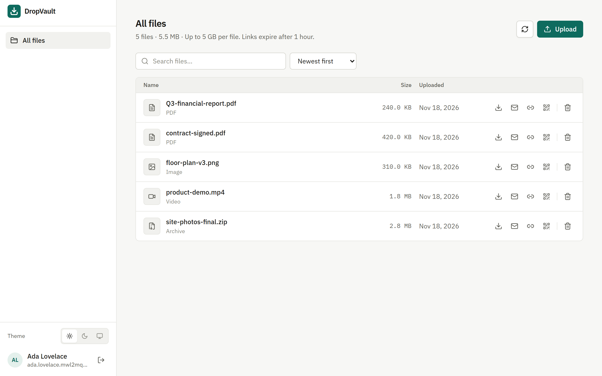
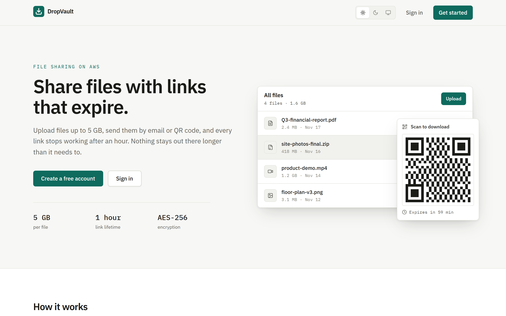
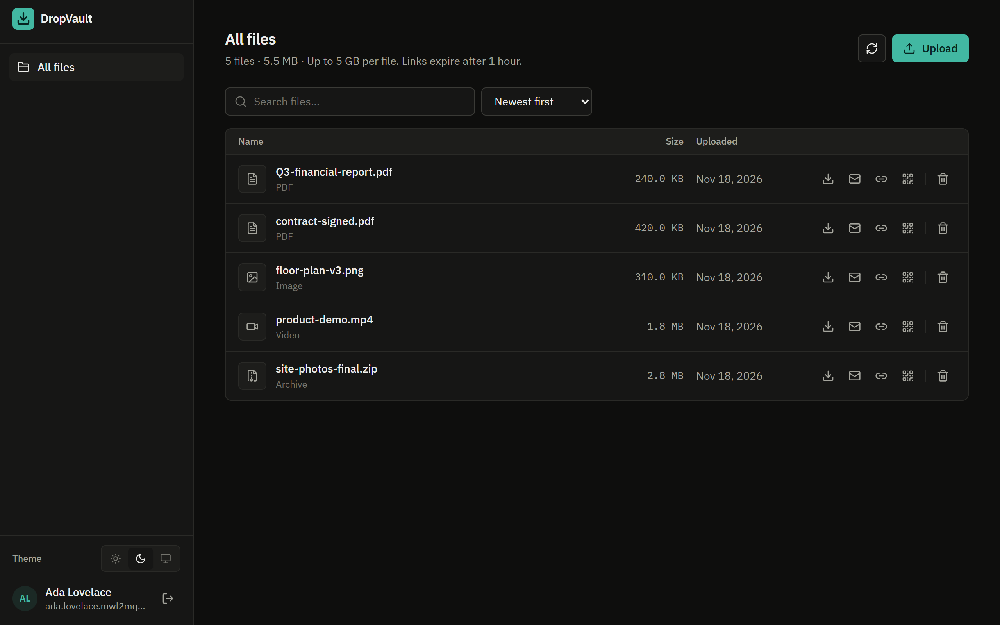
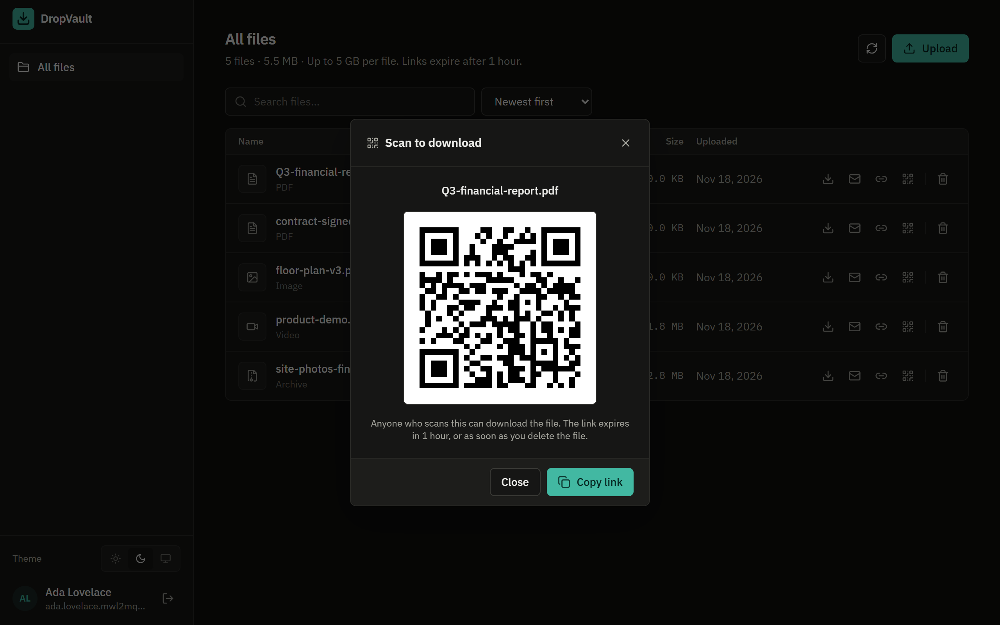

<h1 align="center">DropVault</h1>

<p align="center">
  Share files with links that expire. Serverless on AWS: upload up to 5 GB, share by email, link or
  QR code, choose how long each link works, and turn links off at any time.
</p>

<p align="center">
  <a href="./LICENSE"></a>
  
  
  
</p>

<p align="center">
  
</p>

## Features

- **Direct-to-S3 uploads** up to 5 GB per file. The browser uploads straight to S3 with a presigned URL,
  with live progress. Nothing large passes through a server.
- **You choose how long links work:** 15 minutes, 1 hour (default), 6 hours, 1 day, 7 days or never.
- **Share by email, link or QR code.** Email a file to several people (Amazon SES), copy a short link,
  or show a scannable QR code. All three use the same short link, which redirects to a fresh download.
- **Turn links off.** One click stops every link shared for a file, without deleting the file.
  Deleting the file also stops its links.
- **Clear dead-link pages.** Someone opening an expired or turned-off link sees a short page that says
  so (and when it expired), not a raw storage error.
- **Simple accounts.** Name, email and password. Sessions renew automatically for up to 30 days.
- **Light and dark mode**, following your system setting or chosen manually.
- **Encryption at rest:** SSE-S3 by default, or one KMS key for the app, or one KMS key **per user**.
- **One-command deploy** with Terraform, and a **fully offline mode** using LocalStack.

| Light | Dark |
| --- | --- |
|  |  |
|  |  |

## Architecture

```
                        ┌──────────────────────────┐
  Browser ──────────────► Amplify Hosting          │  React app (static)
     │                  └──────────────────────────┘
     │ REST, Bearer token
     ▼
  API Gateway (REST) ───► Lambda: auth-service ─────► DynamoDB: users
     │                    (sign-up, login, userinfo, refresh)
     │
     ├──────────────────► Lambda: upload, complete, list, download, share, delete
     │                        │  validates the token via  /v1/userinfo
     │                        ├──► DynamoDB: files (metadata, QR link records)
     │                        ├──► S3 (private bucket, SSE-S3 or SSE-KMS)
     │                        ├──► KMS (optional per-user keys)
     │                        └──► SES (share emails)
     │
     └──────────────────► Lambda: qr-link  ── GET /v1/d/{code} → 302 to a fresh S3 download

  Browser ── presigned PUT / GET ──► S3        (file bytes never go through Lambda)
```

The file Lambdas don't know how authentication works. They only call `{AUTH_ENDPOINT}/v1/userinfo`
with the caller's token. By default that's the built-in `auth-service` on the same API, but you can point
`auth_endpoint` at any compatible auth service.

## Project structure

```
.
├── endpoints/                 Python 3.13 Lambda handlers (one folder per function)
│   ├── auth-service/          sign-up, sign-in, userinfo, refresh (PBKDF2 passwords, HMAC tokens)
│   ├── upload-file/           create a file record + presigned PUT URL (optional per-user KMS key)
│   ├── complete-upload/       mark an upload READY and record its real size
│   ├── get-user-files/        list the caller's files
│   ├── download-file/         presigned GET URL (1 hour)
│   ├── share-file/            email a short download link via SES
│   ├── delete-user-file/      delete the S3 object and its record
│   └── qr-link/               short links (create, turn off) + the public redirect
├── terraform/                 all AWS infrastructure
│   ├── deploy.sh              terraform apply → build web app → publish to Amplify / S3
│   ├── auth.tf  qr.tf         the auth and QR Lambdas, their routes and the users table
│   ├── apigateway.tf          REST API, routes, CORS
│   ├── lambda.tf  layers.tf   file Lambdas + the jsonschema layer
│   ├── s3.tf  dynamodb.tf     storage, CORS, TTL for link records
│   ├── kms.tf  ses.tf         encryption modes, sender email identity
│   ├── web.tf                 Amplify Hosting or S3 + CloudFront
│   └── terraform.tfvars.example
├── web/                       React 19 + Vite + Tailwind CSS 4 front end
│   └── src/
│       ├── pages/             Landing, Login, SignUp, dashboard/Files, dashboard/DashboardLayout
│       ├── components/        UI primitives, toasts, auth layout
│       ├── context/           AuthContext (session + automatic token renewal)
│       ├── api/               auth and file API clients
│       └── theme.jsx          light / dark / system theme
├── local/                     offline stack: LocalStack + a local API server running the real Lambdas
└── postman/                   API collection (sign up → upload → share → QR → delete)
```

## Getting started

### Option 1: run it offline (no AWS account)

Needs Docker Desktop, Python 3 (`pip install boto3 jsonschema`) and Node 20+.

```powershell
powershell -ExecutionPolicy Bypass -File local\start.ps1
```

This starts LocalStack (S3, DynamoDB, KMS, SES in Docker), a local API on `http://localhost:4000` that runs
the real Lambda handlers, and the web app on `http://localhost:3001`. Emails are captured, not sent; read
them at `http://localhost:4566/_aws/ses`. Details in [local/README.md](./local/README.md).

### Option 2: deploy to AWS

Needs Terraform ≥ 1.5, the AWS CLI with credentials (`aws configure`), Python 3, Node 20+ and bash
(Git Bash on Windows).

```bash
cd terraform
cp terraform.tfvars.example terraform.tfvars   # set aws_region and sender_email
bash deploy.sh
```

`deploy.sh` runs `terraform apply`, builds the web app with the new API URL baked in, publishes it and
prints both URLs:

```
Web app : https://main.<app-id>.amplifyapp.com
API     : https://<api-id>.execute-api.<region>.amazonaws.com/dev
```

After the first deploy, AWS emails `sender_email` a verification link. Click it, or sharing by email won't work.

Run `bash deploy.sh` again after any change. To remove everything (S3 objects included):

```bash
terraform destroy -var-file=terraform.tfvars
```

### Configuration

The main `terraform.tfvars` settings (see [the example](./terraform/terraform.tfvars.example) for all of them):

| Variable | Default | Purpose |
| --- | --- | --- |
| `aws_region` | `eu-west-1` | Region for everything |
| `sender_email` | - | Address share emails come from (verified by SES on first deploy) |
| `web_hosting` | `amplify` | `amplify`, or `cloudfront` (S3 + CloudFront; new AWS accounts must be verified by AWS Support first) |
| `kms_mode` | `s3` | `s3` (SSE-S3, free), `shared` (one KMS key), `per_user` (one KMS key per user) |
| `auth_endpoint` | `""` | Empty = built-in auth service. Or the URL of an external one |
| `display_name` | `DropVault` | Product name used in share emails |
| `allowed_origins` | `["http://localhost:3001"]` | Extra origins allowed to upload to S3 (the hosted app is always allowed) |
| `bash_bin`, `python_bin` | `/bin/bash`, `python3` | On Windows: `C:/Program Files/Git/bin/bash.exe` and `python` |

## API

All routes are under `/v1`. File routes need `Authorization: Bearer <id_token>`, and the `{user_id}`
in the path must be the caller's own. A ready-made [Postman collection](./postman/DropVault.postman_collection.json)
saves the token and IDs for you.

**Auth**

| Request | Response |
| --- | --- |
| `POST /users` `{full_name, email, password}` | `201 {user_id, email, id_token, access_token, refresh_token, expires_in}` |
| `POST /login` `{email, password}` | `200 {id_token, access_token, refresh_token, expires_in}` |
| `GET /userinfo` | `200 {user_id, name, email}` |
| `POST /refresh-token` `{refresh_token}` | `200` new tokens |

**Files**

| Request | Response |
| --- | --- |
| `GET /users/{user_id}/files` | `{user_files: [{file_id, file_name, content_type, size, uploaded_at, status}]}` |
| `POST /users/{user_id}/files` `{file_name, content_type, size}` | `201 {file_id, upload_url, upload_headers}` |
| `PUT {upload_url}` (straight to S3) | the file bytes, same `Content-Type`, plus `upload_headers` |
| `POST /users/{user_id}/files/{file_id}/complete` | `{file_id, size, status: "READY"}` |
| `GET /users/{user_id}/files/{file_id}/download` | `{download_url}` (1 hour) |
| `POST /users/{user_id}/files/{file_id}/share` `{share_with: [emails], expires_in}` | `201 {file_id, file_name, status, expires_at}`, emails a short link |
| `POST /users/{user_id}/files/{file_id}/qr` `{expires_in}` | `201 {short_url, expires_at}` |
| `DELETE /users/{user_id}/files/{file_id}/qr` | `{file_id, links_revoked_at}`, turns off every link to the file made so far |
| `GET /d/{code}` (public) | `302` to a fresh download, or a "not found", "expired" or "turned off" page |
| `DELETE /users/{user_id}/files/{file_id}` | `{file_status: "DELETED"}` |

`expires_in` is one of `900`, `3600`, `21600`, `86400`, `604800` (seconds) or `"never"`. It defaults to
`3600`. `expires_at` is a Unix timestamp, or `null` for links that never expire.

Files are stored at `s3://<bucket>/{user_id}/{file_id}/{file_name}`.

## How it works

**Accounts and sessions.** Passwords are hashed with PBKDF2-SHA256 (200,000 rounds). Tokens are
HMAC-SHA256 signed and carry their own expiry, so the server stores no sessions. ID and access tokens last
1 hour and refresh tokens 30 days. The web app renews tokens a minute before they expire, and again when
a tab wakes from sleep.

**Uploads.** The app asks the API for a presigned PUT URL, uploads the file straight to S3 with progress,
then marks it complete. S3 accepts up to 5 GB in a single PUT, and the app checks this before uploading.

**Short links.** Email shares, copied links and QR codes all use the same short link. A presigned S3 URL
is about 1,500 characters (too dense for a QR code), and it stops working when the Lambda's temporary
credentials expire, after a few hours at most. So the app stores a 12-character code in DynamoDB instead
(`links.py`, shared by `qr-link` and `share-file`), and each visit to `/d/{code}` gets a fresh 5-minute
download URL. This is what makes long and never-expiring links work.

Each link record keeps its creation time and, unless it never expires, an expiry time that DynamoDB TTL
uses to delete it. Turning a file's links off stamps `links_revoked_at` on the file record, and any link
created before that moment stops working. New links made afterwards work as normal.

**Encryption (`kms_mode`).** `s3` uses SSE-S3 (AES-256, free). `shared` sets one customer-managed KMS
key as the bucket default (about $1/month). `per_user` creates one KMS key per user on their first
upload (about $1/user/month), so one user's files can't be decrypted with another user's key. Key
creation uses a DynamoDB conditional write as a lock, so each user gets exactly one key.

## Cost

At personal or demo scale this runs for about **$0 to $1 a month**. Lambda, API Gateway and DynamoDB
on-demand are pay-per-request with free tiers, and S3 costs about $0.025 per GB-month. `per_user` KMS adds
about $1 per user per month.

## Security notes

- Every bucket is private. Files are only ever reached through presigned URLs that expire within
  5 minutes (shared links) or 1 hour (your own downloads).
- A link set to **never** expire lets anyone who has it download the file until you turn its links off
  or delete the file. The app warns about this when you pick it.
- File routes check the token on every request and require the path `user_id` to match it.
- Sign-up is intentionally simple: there's no email verification, MFA or rate limiting on login.
  For production use, add those or point `auth_endpoint` at a managed auth service.
- New AWS accounts start in the **SES sandbox**, which only sends to verified addresses. Request
  production access in the SES console to email anyone.

## Roadmap

- [ ] Multipart uploads (files over 5 GB, resumable uploads)
- [x] Turn shared links off before they expire
- [x] Choose how long each link works
- [ ] Turn off a single link instead of all of a file's links
- [ ] Custom domain for the web app

## License

MIT. See [LICENSE](./LICENSE).
