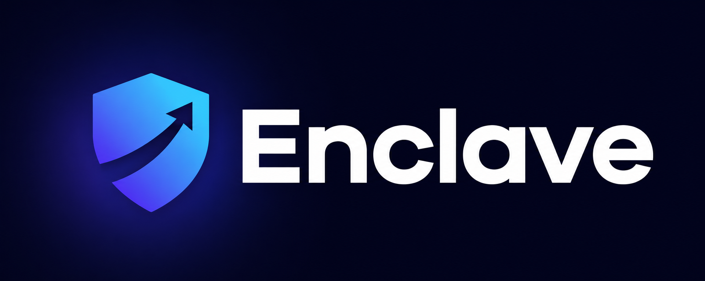

<p align="center">
  
</p>

<h1 align="center">DropVault — Secure File Sharing on AWS</h1>

[](https://opensource.org/licenses/MIT)
[](https://aws.amazon.com/)
[](https://www.python.org/)
[](https://react.dev/)

> Serverless file sharing on AWS: direct-to-S3 uploads (up to 5 GB per file), short-lived presigned
> downloads, email sharing with expiring links, **scan-to-download QR codes**, **optional per-user
> KMS encryption**, and a sleek React front end.

> **Credits:** DropVault is built on [Enclave](https://github.com/TocConsulting/enclave) by
> TocConsulting (MIT license, see [LICENSE](./LICENSE)). The app UI still uses the Enclave name.

## ✨ What DropVault adds

- **Built-in simple auth** - email + password sign-up and sign-in served by its own Lambda
  ([`endpoints/auth-service`](./endpoints/auth-service)) on the same API, with automatic session
  renewal. No separate auth microservice to deploy (an external one can still be used via `auth_endpoint`).
- **QR codes** - a QR button on every file opens a scannable code; short links
  ([`endpoints/qr-link`](./endpoints/qr-link)) redirect to a fresh download and stop working after
  1 hour or when the file is deleted.
- **Web hosting in Terraform** - AWS Amplify Hosting (works on new AWS accounts) or S3 + CloudFront,
  plus a one-command [`terraform/deploy.sh`](./terraform/deploy.sh) that deploys infra, builds the app
  and publishes it.
- **Fully offline mode** - [`local/`](./local) runs everything on your machine with LocalStack
  (S3, DynamoDB, KMS, SES in Docker) and the real Lambda handlers. See [local/README.md](./local/README.md).
- **UI polish** - in-app delete confirmation, 5 GB upload guard, layout fixes. Windows-friendly build scripts.

### Quick deploy

```bash
cd terraform
cp terraform.tfvars.example terraform.tfvars   # set aws_region, sender_email (+ bash_bin/python_bin on Windows)
bash deploy.sh                                 # terraform apply + build web app + publish
```

AWS emails `sender_email` a verification link on first deploy - click it to enable sharing by email.

---

*The original Enclave documentation follows. Where it mentions CognitoApi / MFA sign-up, DropVault
uses the built-in simple auth described above instead.*

## 🎯 Key features

- **🔌 Microservice-decoupled auth** - Enclave validates and resolves the caller by calling the auth
  service's `/v1/userinfo`. No identity store, SDK, or infrastructure is shared; the only auth config
  is just an **endpoint**.
- **⬆️ Direct-to-S3 uploads** - the browser PUTs straight to S3 against a presigned URL (up to 5 GB per file,
  real progress) using SigV4 on the regional endpoint.
- **⬇️ Owner downloads & email sharing** - short-lived (1 hour) presigned links; share to anyone by email via SES.
- **🔐 Optional per-user KMS encryption** - `kms_mode` of `s3` (free), `shared` (one customer key), or
  `per_user` (one KMS key **per user** - true cryptographic isolation).
- **🗂️ Rich metadata** - name, size, content type, upload date and status in DynamoDB.
- **🧱 One-command IaC** - `make apply` builds + deploys everything; `make destroy` removes it all,
  including the runtime KMS keys and every stored object. No orphans.
- **🖥️ Modern front end** - dark, brand-matched React 19 + Vite + Tailwind app (sign-up, MFA login, dashboard).

## 🏛️ Architecture

```
Browser ── presigned PUT (SigV4) ─────────▶  S3 (private, optional SSE-KMS)
   │                                            ▲
   │  REST (Bearer IdToken)                     │ presigned GET (download / share)
   ▼                                            │
API Gateway ──▶ Lambda (Python) ──▶ DynamoDB (file metadata + per-user key lock)
                     │   │
                     │   └──▶ KMS  (per-user key, created once via a DynamoDB lock)
                     │
                     ├──▶ Auth microservice  /v1/userinfo   (validate token, resolve user)
                     └──▶ SES                                 (share emails)
```

The API methods are **open** (no API key); the bearer token is validated **in the Lambda** by calling the
auth service - there is no Cognito authorizer, so Enclave is independent of the auth implementation.

## 📚 API reference

All endpoints require `Authorization: Bearer {IdToken}`. The Lambda resolves `user_id`
from the auth service and enforces that the path user matches the token.

| Action | Request | Response |
| --- | --- | --- |
| **Create upload** | `POST /v1/users/{user_id}/files`<br>`{file_name, content_type, size}` | `{file_id, upload_url, upload_headers, status:"UPLOADING"}` |
| **(browser)** | `PUT {upload_url}` with the bytes + `Content-Type` (+ `upload_headers` for SSE-KMS) | S3 stores the object |
| **Complete upload** | `POST /v1/users/{user_id}/files/{file_id}/complete` | `{file_id, size, status:"READY"}` |
| **List files** | `GET /v1/users/{user_id}/files` | `{user_id, user_files:[{file_id, file_name, content_type, size, uploaded_at, status}]}` |
| **Download** | `GET /v1/users/{user_id}/files/{file_id}/download` | `{file_id, file_name, download_url}` (1 h) |
| **Share** | `POST /v1/users/{user_id}/files/{file_id}/share`<br>`{share_with:[emails]}` | `{file_id, file_name, status:"SHARED"}` + emails a 1 h link |
| **Delete** | `DELETE /v1/users/{user_id}/files/{file_id}` | `{file_id, file_name, file_status:"DELETED"}` |

Objects are stored under the key `{user_id}/{file_id}/{file_name}`.

## ☁️ Deploy the backend (Terraform, one command)

Provisions the S3 bucket (+ CORS), DynamoDB, the **6 Python Lambdas** + dependency layer, API Gateway
(routes), IAM, KMS (per `kms_mode`), and an optional custom domain - all from
[`terraform/`](./terraform). Terraform packages the Lambdas itself (no manual build step).

**Prerequisites:** Terraform ≥ 1.5, AWS CLI configured, Python 3 + `pip` + `zip`, a running **auth
microservice**, and a **verified SES identity** for the sender address.

```bash
cd terraform
cp terraform.tfvars.example terraform.tfvars   # then fill in the values
make apply        # builds lambdas + layers, deploys everything
make output       # api_url, bucket, table
```

Key `terraform.tfvars` values:

| Variable | Purpose |
| --- | --- |
| `auth_endpoint` | the auth microservice this API delegates token validation to |
| `files_bucket_name` | globally-unique S3 bucket |
| `sender_email`, `sender_ses_arn` | verified SES identity for share emails |
| `allowed_origins` | frontend origins allowed to upload/download directly to S3 |
| `kms_mode` | `s3` \| `shared` \| `per_user` (see below) |
| `api_domain_name`, `route53_zone_id` | optional custom domain (Enclave issues its **own** ACM cert) |

`make destroy` tears everything down — including the **per-user KMS keys created at runtime** (a
destroy-time hook deletes their aliases and schedules the keys for deletion) and **all stored objects**
(`force_destroy`). Nothing is left orphaned. (KMS enforces a 7-day minimum deletion window; keys are
disabled immediately, so no further access or billing.)

## 🔐 Encryption modes (`kms_mode`)

| Mode | What it does | Cost |
| --- | --- | --- |
| `s3` (default) | SSE-S3 (AES-256) | free |
| `shared` | one customer-managed KMS key, set as the bucket default | ~$1/mo + requests |
| `per_user` | **one KMS key per user**, created on first upload and reused thereafter | ~$1/user/mo + requests |

In `per_user` mode each user's objects are encrypted under **their own** key, so one user's data can
never be decrypted with another's. The key is created **exactly once per user**, guarded by an atomic
DynamoDB conditional write (no races, no orphaned keys), and the browser PUT carries the SSE-KMS headers
returned in `upload_headers`.

## 🖥️ The web app (`web/`)

A standalone, deployable product (not a demo): a dark, brand-matched React app - landing page,
**sign-up** (create account → email confirmation → mandatory TOTP MFA) and **sign-in**, then a dashboard
with drag-and-drop uploads (live progress), a type-aware file library with search/sort, and
Download / Share / Copy-link / Delete.

It's an **independent microservice client**: its dependencies (the auth service and the Enclave File API)
are wired in at **build time** via env vars - there is no runtime "connect your API" step.

```bash
cd web
npm install
cp .env.example .env.local      # fill in your endpoints
npm run dev                     # http://localhost:3001  (landing -> sign up / sign in -> app)
```

Configuration (set before `npm run build`, e.g. in CI):

```
VITE_AUTH_URL=https://auth.example.com    # auth microservice
VITE_FILE_URL=https://files.example.com   # Enclave File API (make output); omit if same gateway
```

### Deploy the app (served at your domain)

`npm run build` produces a static `dist/`. Host it on S3 + CloudFront + ACM + Route53 at your domain
(e.g. `https://share.example.com`):

1. Build with the env vars above baked in.
2. Upload `dist/` to a private S3 bucket fronted by CloudFront (OAC), with a custom error response
   `403/404 -> /index.html` (SPA routing) and an ACM cert for the domain.
3. Point a Route53 alias at the distribution.
4. Add that domain to the backend `allowed_origins` and re-run `make apply` so S3 CORS permits it.

The product name lives in `web/src/brand.js` (one constant).

## 🔒 Security notes

- Mandatory MFA on the auth side; the bearer token is validated on every request via the auth service.
- Files are private; access is only ever granted through short-lived (1 h) presigned URLs.
- `per_user` KMS gives per-user cryptographic isolation and crypto-shredding (deleting a user's key
  makes their files unrecoverable).

## 🚧 Roadmap

- [x] Infrastructure as Code (Terraform) for the whole stack
- [x] Per-user customer-managed KMS encryption
- [ ] Multipart uploads for very large files
- [ ] Share management (revoke links, see who has access)

## 📄 License

MIT - see [LICENSE](./LICENSE).

## 👨‍💻 Author

**Tarek CHEIKH** - [@TocConsulting](https://github.com/TocConsulting) · [tocconsulting.fr](https://tocconsulting.fr)
